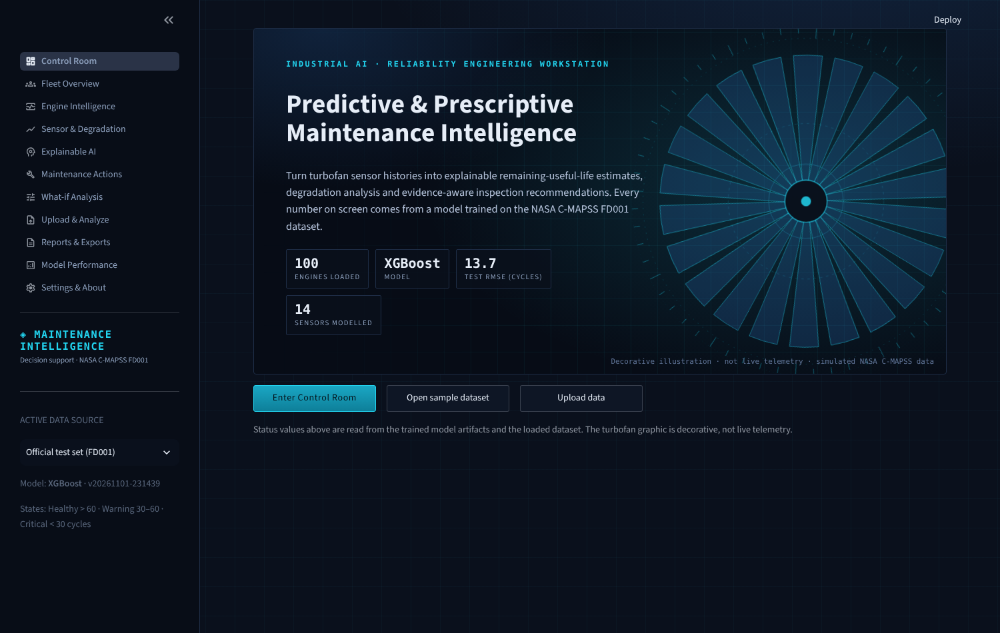

# Industrial Predictive & Prescriptive Maintenance Intelligence Platform

An end-to-end, data-driven decision-support application built on the **NASA C-MAPSS FD001** turbofan degradation simulation.
It estimates remaining useful life (RUL), derives a health state, explains predictions with SHAP, analyses degradation and anomalies,
generates evidence-aware maintenance recommendations, runs what-if scenarios, ranks a fleet, accepts CSV uploads and exports PDF/CSV reports.

> **Scope & honesty.** The data are simulated. The app supports, and does not replace, an authorised maintenance engineer.
> Every number shown comes from the saved model or the loaded data; nothing is hard-coded. See [Limitations](#limitations).



## Quick start

```bash
python -m venv .venv && source .venv/bin/activate      # Python 3.11+ (developed on 3.13)
pip install -r requirements.txt
python -m src.train_models        # ~3-4 min on 2 CPU cores; writes models/ and artifacts/
pytest -q                          # 32 tests
streamlit run app.py               # http://localhost:8501
```
Trained artifacts are included in `models/` and `artifacts/`; re-run training to reproduce them (`--quick` is a smoke run only, never for reporting).
If artifacts are missing the app shows a setup message instead of fake results.

## Dataset verification (Phase 1)
The archive contained FD001–FD004, `readme.txt`, the PHM08 paper and a stray `x.txt` (218 single-column rows, matches no subset → ignored).
Scope = **FD001**. Contents were verified rather than trusting file names: 26 whitespace-separated columns, 100 train / 100 test engines, 100 RUL values,
`op3` constant (single operating condition). Train 20,631 rows (128–362 cycles/engine); test 13,096 rows (31–303 cycles). No missing/duplicate/non-contiguous records.
Seven sensors have ≤2 distinct training values (Sensors 1, 5, 6, 10, 16, 18, 19) and are excluded (derived from data at training time); **14 sensors** are modelled.
Sensors are labelled only "Sensor N" — no physical names are assumed. FD002–FD004 (six operating conditions) are out of scope.

## Method
| Item | Choice |
|---|---|
| Train target | `RUL = final_cycle − cycle`; raw and capped (`RUL_CAP = 125`, configurable in `src/config.py`) kept in separate columns |
| Test target | One official RUL per engine, valid **only at the last observed cycle**; never assigned row-wise |
| Features (70) | per sensor: current value, 10-cycle rolling mean / std / slope, shift vs the engine's own early baseline (first 5 cycles). All **causal** (past data only; unit-tested) |
| Validation | Engine-grouped 5-fold CV (`GroupKFold`) for feature-set choice, tuning and model selection. Official test evaluated **once**, at final cycles |
| Candidates | Dummy (mean), Ridge, Random Forest, HistGradientBoosting, XGBoost — small tuning grids, seed 42 |
| Selection | Lowest CV RMSE; among models within 2% prefer a SHAP-supported one → **XGBoost** |

### Measured results (cycles; produced by `src.train_models`)
| Model | CV MAE | CV RMSE | CV R² | RMSE late-life (RUL≤60) | RMSE random cut-off/engine | Train s |
|---|---|---|---|---|---|---|
| **XGBoost** | 8.71 | **12.58** | 0.91 | 10.53 | 13.71 | 1.3 |
| HistGradientBoosting | 8.72 | 12.68 | 0.91 | 10.65 | 13.79 | 1.5 |
| Random Forest | 9.04 | 12.80 | 0.91 | 11.13 | 14.10 | 12.6 |
| Ridge | 12.40 | 15.63 | 0.86 | 17.92 | 16.98 | 0.02 |
| Dummy (mean) | 36.97 | 41.67 | −0.00 | 59.49 | 42.32 | 0.0 |

**Official test (100 engines, final cycle, XGBoost):** vs. capped truth MAE 9.58, RMSE 13.66, R² 0.884, NASA score 275; vs. raw (uncapped) truth MAE 10.65, RMSE 14.67, R² 0.875, NASA score 301.
The capped comparison puts prediction and truth on the same scale; the raw comparison is shown for transparency (engines with true RUL > 125 are under-predicted by construction).
XGBoost and HistGradientBoosting differ by <1% CV RMSE — not a meaningful gap.

**Feature ablation** (HistGB, same CV): current sensors only 18.64 RMSE → + rolling stats 18.00 → + shift vs engine baseline **12.81**. Adding the raw cycle count lowered CV RMSE further (11.11), but it was deliberately **not used**:
the pipeline then depends only on sensor behaviour (not on cycle bookkeeping that is awkward for uploads and what-if). This is a trade-off, listed under future work.

**Derived states** (Healthy > 60, Warning 30–60, Critical < 30 predicted cycles; configurable) are decision-support rules. They have no independent labels, so **no accuracy is reported** for them.

## Explainability, anomaly analysis, recommendations
* **SHAP** (`TreeExplainer`): global importance + summary plot on a documented 1,500-row training sample (seed 42); local explanation per engine/cycle, grouped by sensor; text generated from the computed values. SHAP = model attribution, **not causation**; no component diagnosis is made. If an explainer is unavailable the UI says so.
* **Anomaly detector** (separate from RUL): Isolation Forest fitted on early-life (cycles 10–50) 10-cycle-mean shifts from each engine's baseline; flag threshold = 99th percentile of reference scores. Sanity check on training data (no fault labels exist): flagged 9.9% of rows when true RUL > 125, 64.3% for 60–125 and 99.9% for ≤ 60 (Spearman ρ = 0.88 with elapsed life). This shows the score tracks progression — it is not a fault-classification accuracy.
* **Rules registry** (`src/recommendation_engine.py`): each rule has ID, trigger, evidence, priority, evidence-strength category (Strong / Moderate / Informational, defined in the code and UI), source, limitation, verification step and status (Pending / In Progress / Completed / Dismissed — session-only, exportable). Rules are application conventions; none maps a sensor to a component or promises a quantified life extension. Sensor-shift findings read "potential contributing pattern identified; further engineering inspection required".

## What-if analysis
Edits only the sensors you select, on the **latest observed cycle** of a copy of the engine data (originals untouched); rolling features are recomputed causally. Values outside the training min/max are rejected, tail values (outside 1st–99th percentile) and large jumps produce warnings, and every result carries the disclaimer that this is model response, not a physical or causal effect.

## Upload & Analyze
Select file → preview → column mapping (auto-detected: `unit/engine_id`, `cycle/time`, `s2`/`Sensor 2`/`sensor_2`…) → validation report → confirm → inference → CSV download. 20 MB / 500k-row limit; files are parsed as data only. Missing values are errors (never zero-filled).
* **Mode A** compatible trajectories (no ground truth → unverifiable, stated). * **Mode B** + NASA-format RUL file → metrics computed. * **Mode C** missing sensors or values far outside the training range (>50% median out-of-range) → no prediction; the app explains what is incompatible and what retraining/mapping/data would be needed.
A template CSV (two real FD001 test engines) can be downloaded in-app.

## Application map
Control Room (+ immersive entry) · Fleet Overview · Engine Intelligence (staged reveal: validation → health → RUL count-up → sensors → SHAP → actions; critical states are never delayed; animations are tied to real computed results and respect `prefers-reduced-motion`) · Sensor & Degradation (EDA, per-engine degradation, anomalies) · Explainable AI · Maintenance Actions · What-if · Upload & Analyze · Reports & Exports (engine & fleet PDF via ReportLab, CSV) · Model Performance · Settings & About.
Screenshots: `docs/screenshots/`.

## Project layout
```
app.py, pages/*.py          Streamlit UI (thin; logic lives in src/)
src/data_loader.py, data_validation.py, rul_target.py, feature_engineering.py
src/train_models.py, evaluate_models.py, inference.py, explainability.py
src/anomaly_detection.py, recommendation_engine.py, what_if_engine.py, fleet_analysis.py
src/engine_analysis.py, report_generator.py, upload_mapping.py, app_state.py, ui_components.py, config.py
models/ (rul_model.joblib, anomaly_model.joblib, model_metadata.json)   artifacts/ (metrics, comparison, OOF/test predictions, SHAP sample, logs)
data/ (FD001 files + readme + PHM08 paper)   tests/   .streamlit/config.toml
```

## Testing
`pytest -q` → **32 passed** (loading/schema, subset identity, RUL targets, train/test alignment, validation errors, ordering, future-data leakage incl. slope vs `polyfit`, feature order, model save/reload, prediction validity, saved-metric reproduction, threshold boundaries, NASA score, rule triggers, what-if validation & immutability, PDF generation incl. missing sections, upload parsing/mapping, malformed/oversized files, unsupported schema/units, single-engine and short-trajectory edge cases). All 11 pages were additionally loaded headlessly and the main journey (entry → fleet → engine analysis → SHAP → what-if → pages) was driven in a real Chromium browser.

## Troubleshooting
* *"Trained model artifacts were not found"* → `python -m src.train_models`.
* *Upload rejected* → read the data-quality table; fix missing/duplicate/non-numeric values or map the required 14 sensors.
* *SHAP unavailable* → only occurs if a non-tree/non-linear model is selected (HistGradientBoosting is not supported by SHAP's TreeExplainer).
* XGBoost missing → training skips it and records `xgboost_available=false`; the UI uses whatever model was selected.

## Limitations
Simulated single-condition, single-fault data; estimates capped at 125 cycles with ~13–15 cycle RMSE; sensors unnamed physically; anomaly detector unvalidated; action status not persisted between sessions; no streaming, costs, downtime or savings modelled; one dataset/model (FD002–FD004, uncertainty estimates, sequence models, drift monitoring, FastAPI endpoint, rule editor, work orders are future extensions — **not implemented**).

## References
A. Saxena, K. Goebel, D. Simon, N. Eklund, *Damage Propagation Modeling for Aircraft Engine Run-to-Failure Simulation*, PHM08 (`data/docs`). NASA PCoE C-MAPSS dataset. S. Lundberg & S.-I. Lee, *A Unified Approach to Interpreting Model Predictions*, NeurIPS 2017.
